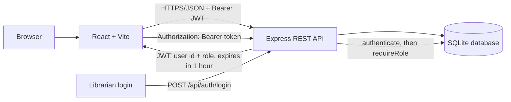
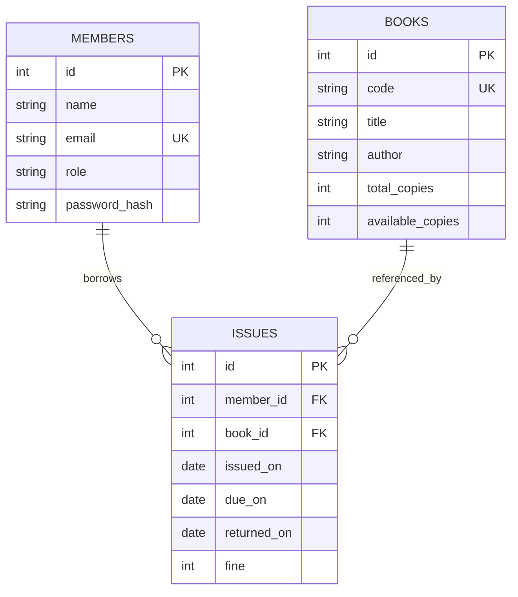

# RollNo_BookNest — BookNest Library Tracker

A full-stack library tracker built for the Full Stack Development Lab. Replace `RollNo` in the repository/folder name with your actual roll number before submission.

## Architecture

## ER diagram

## API contract

| Method | Endpoint | Access | Success response (example) |
|---|---|---|---|
| POST | `/api/auth/login` | Public | `200 {"token":"<jwt>","user":{"id":1,"name":"Admin","email":"admin@lib.example","role":"librarian"}}` |
| GET | `/api/books?search=&page=&limit=` | Logged in | `200 {"data":[...],"page":1,"limit":10,"total":5,"totalPages":1}` |
| POST | `/api/books` | Librarian | `201 {"data":{...}}` |
| POST | `/api/issues` | Librarian | `201 {"data":{...}}` |
| POST | `/api/issues/:id/return` | Librarian | `200 {"fine":12}` |
| GET | `/api/issues/overdue` | Librarian | `200 [...]` |
| GET | `/api/issues/mine` | Member | `200 [...]` |

Errors use `{"error":{"code":"...","message":"..."}}`. Important conflict codes: `NO_COPIES`, `LIMIT_REACHED`, `ALREADY_RETURNED`.

## Database and index

SQLite stores `members`, `books`, and `issues`; constraints enforce unique email/book code, valid roles, non-negative copy counts, and available copies not exceeding total copies. All SQL values are parameterised.

The index on `issues(member_id, returned_on)` speeds up finding a member's active issues (`returned_on IS NULL`) and counting active loans for the three-book limit.

## Token storage trade-off

This demo stores the JWT in `localStorage` for a simple lab setup; an XSS vulnerability could expose it. A production deployment should consider secure, HttpOnly, SameSite cookies plus CSRF protection and a stronger CSP.

## Seed accounts

All seeded users use `Pass@123` (bcrypt hash only):
- `admin@lib.example` — librarian
- `aarav@lib.example` — member
- `meera@lib.example` — member
- `rohan@lib.example` — member

## Run locally

From `server/`:
1. `npm ci`
2. `npm run seed`
3. `npm run dev`

In another terminal, from `client/`: `npm ci` then `npm run dev`.

The API defaults to `http://localhost:4000`; Vite runs at `http://localhost:5173`.

## Tests

Run from `server/` with `npm test`. Tests use a separate SQLite file and reset it before each test.

## Docker

From `server/`, build with `docker build -t booknest-api .` and run with environment variables configured. The container runs as the non-root `node` user.

## CI

GitHub Actions installs the server dependencies and runs the automated tests on each push and pull request.

## Suggested meaningful commit plan

Make actual separate commits as you complete each stage (do not create fake history): repository structure; schema and seed; authentication; books API; issue/return transactions; tests; React UI; Docker/CI/docs.
